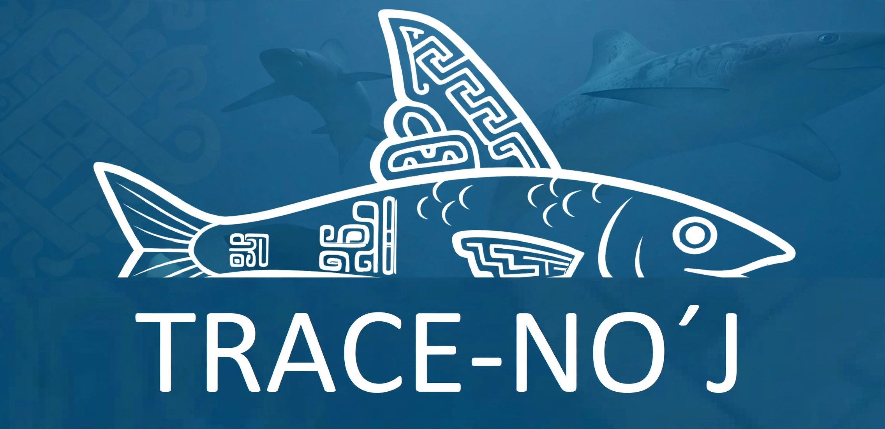

# TraceNo'j — La traza, explicada

▶️ **Probar la demo:** https://kuckling.github.io/trace-noj/

Laboratorio e intérprete de trazas VoIP (SIP y Q.931) en un solo archivo HTML, sin dependencias externas: funciona 100% offline, en el navegador del celular o la PC.

## Qué es

Una aplicación para técnicos de telcos que no saben interpretar una traza. Pegas la traza y te muestra:

1. 🪜 **El flujo de la llamada** en un diagrama de escalera (llamante ↔ PBX/gateway, o terminal ↔ red).
2. 📝 **La explicación paso a paso** de cada mensaje, en español claro.
3. 🔍 **El diagnóstico**: dónde murió la llamada (o si se completó), la causa en lenguaje claro y qué revisar.

Detecta sola si la traza es **SIP**, **Q.931** o un **log de FreeSWITCH**. Si no reconoce el formato, lo dice con honestidad en vez de inventar.

Además trae un **Laboratorio** con 7 casos ficticios para practicar (llamada exitosa, ocupado, sin circuito causa 34, audio en un solo sentido, registro rechazado 401/403 estilo Dinstar, tiempo agotado 408 estilo syslog, sin servicio por TLS estilo FreeSWITCH) y una pestaña de **Causas** con las tablas Q.931 y SIP.

## Cómo se usa

1. Abre `index.html` en el navegador (doble clic, sin instalar nada).
2. Pestaña **Intérprete**: pega la traza en el cuadro de texto y pulsa **Interpretar traza**. También puedes cargar un ejemplo del desplegable.
3. Pestaña **Laboratorio**: lee cada caso, responde la pregunta en tu cabeza y pulsa **Ver respuesta**.
4. Pestaña **Causas**: consulta rápida de códigos SIP y causas Q.931.

Consejo: en una traza real, borra o cambia los números y las IP antes de pegarla. La app no los necesita para explicar el flujo, y ninguna traza sale de tu equipo: todo se procesa en el navegador.

## Lo que entiende (v1.4)

- 📟 **Logs de FreeSWITCH (sofia)**: extrae el SIP crudo de los bloques `recv N bytes from ...` / `send N bytes to ...` (con su línea de guiones de cierre), con prefijo propio de FreeSWITCH (`2026-11-25 08:10:01.123456 [DEBUG] sofia.c:1234`) o envuelto en syslog (`Nov 25 08:10:01 host freeswitch[4600]:`). La escalera usa los actores reales (equipo remoto ↔ FreeSWITCH) y la dirección recv/send. Si el fragmento solo trae líneas de diagnóstico (sin SIP), no dice "no reconozco": convierte las líneas en pistas — `TLS handshake failed` → posible problema de certificados/TLS; `parse domain ... failed` → posible problema de DNS o de configuración del dominio. Las líneas de ruido (`agent_timer` y similares) se ignoran.
- 🏷️ **Prefijos de log**: acepta trazas reales con timestamps (`[2026-11-25 08:00:00.123]`, `Nov 25 08:05:12`), IP:puerto, niveles (INFO/DEBUG), etiquetas `[SIP]` o nombre del equipo (syslog) al inicio de línea, y prefijos `TX:`/`RX:` antes del mensaje. La detección no se rompe por el prefijo.
- 📞 **SIP**: peticiones INVITE, ACK, BYE, CANCEL, REGISTER, OPTIONS y otras; respuestas 1xx, 2xx, 4xx, 5xx, 6xx; cabeceras From, To, Call-ID, CSeq, Contact; SDP (códecs ofrecidos y contestados, IP de media, puerto, dirección). El SDP válido se busca también en el **183 Session Progress** (el 200 OK puede venir sin SDP); "Códecs contestados" usa ese mismo respaldo. Si el 183 y el 200 OK traen SDP distinto, la cajita Media lo anota (el SDP cambió entre el audio temprano y la respuesta final) como observación, no como falla. Detecta `m=audio 0` (media rechazada) y `a=inactive`/`sendonly`/`recvonly` (media retenida o en un solo sentido). Si la captura trae varios Call-ID, avisa y analiza la llamada del INVITE; las retransmisiones se marcan como tales; los OPTIONS (keepalives del SBC) se apartan del flujo. Los actores de la escalera se detectan desde la traza (Gateway, SBC, IMS, PBX).
- 📠 **Q.931**: SETUP, CALL PROCEEDING, ALERTING, CONNECT, DISCONNECT, RELEASE, RELEASE COMPLETE y más; el Cause IE en muchos formatos (`Cause value: 34`, `Cause=34`, `cause: 16`, `Q.931 cause 34`, `Release Cause: 41`, `Cause [82] - ...`, `Cause: 16 (Normal Clearing)`, hex `0xA2` → 34). Extrae número origen, número destino y canal/timeslot cuando aparecen.
- 🔍 **Diagnóstico**: además de dónde murió la llamada y su posible origen, muestra una cajita **Media (SDP)** con la IP de c=, los códecs negociados y cualquier cambio de dirección de media.
- ⚠️ **Detecciones**: 486 ocupado, 404, 408, 480, 503, 488, 603, 401/403 de registro; causa Q.931 34 (sin circuito) y las demás de la tabla; SDP con `c=0.0.0.0` (sin media); IP privada en el SDP (riesgo de NAT); códec contestado distinto al ofrecido; falta de ACK tras el 200 OK; INVITE sin respuesta.

Regla de honestidad: desde la señalización **no se puede probar** el audio en un solo sentido; la app lo marca como **sospecha**, nunca como certeza. Para confirmarlo hay que ver el RTP (Wireshark) o preguntar qué lado no escuchaba.

## Cómo publicarla en GitHub Pages

1. Crea un repositorio público en GitHub (nombre sugerido: `trace-noj`).
2. Sube `index.html`, `README.md`, `LICENSE` y las imágenes (`tracenoj-icono.png`, `tracenoj-presentacion-v5.png`) a la raíz del repositorio.
3. En el repositorio: **Settings → Pages → Source: Deploy from a branch → Branch: main → Save**.
4. En 1–2 minutos la app estará en `https://tu-usuario.github.io/trace-noj/`.

## Archivos

- `index.html` — la aplicación completa (HTML + CSS + JS en un solo archivo).
- `README.md` — este archivo.
- `LICENSE` — CC BY-NC-SA 4.0.
- `tracenoj-presentacion-v5.png` — imagen de presentación (pez kay).
- `tracenoj-icono.png` — icono del pez kay.

## Autor

Marlon Estuardo Alvarado Kuckling · Guatemala · CC BY-NC-SA 4.0
